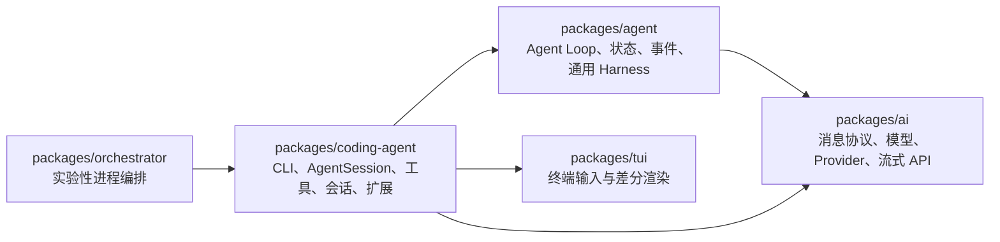

# Pi Agent 工程完整学习计划

> 适用对象：有嵌入式/C 语言工程经验，但缺少 Node.js、TypeScript 和 Agent 架构基础的学习者。
>
> 推荐周期：12 周，每周 6～8 小时。不要把“周”理解为硬期限；每一周实际是一个可以独立验收的学习阶段。

## 一、最终目标

完成这条路线后，你应该能够：

1. 用自己的话解释 LLM、消息、上下文、工具调用、Agent Loop、会话和上下文压缩之间的关系。
2. 从 `pi` 命令一路追踪到模型请求、工具执行，再追踪事件如何返回终端界面。
3. 看懂 Pi 中与 Agent 主链相关的 TypeScript，不要求精通整个 TypeScript 类型系统。
4. 使用假模型构造可重复、无 API 费用的 Agent 测试。
5. 编写一个工具、一个 Skill 和一个 Pi Extension。
6. 独立判断需求应该修改 `ai`、`agent`、`coding-agent`、`tui`，还是只写扩展。
7. 完成一个面向嵌入式场景的“故障分析 Agent”。

这份计划不以“把仓库每个文件读完”为目标。Pi 当前源码超过十万行，线性阅读既低效，也不利于建立架构认知。学习主线是：

```text
先理解数据协议
→ 再理解最小 Agent Loop
→ 再理解状态和事件
→ 再理解 Pi 如何把内核包装成产品
→ 最后学习扩展、会话、TUI 和多 Agent
```

## 二、先建立正确的 Agent 心智模型

Agent 不是一个神秘的新运行时。最小 Agent 可以理解为一个带反馈的异步状态机：

```text
用户消息
  ↓
把 system prompt、历史消息和工具描述发给模型
  ↓
模型返回文本，或者请求调用工具
  ↓
如果请求工具：校验参数 → 执行工具 → 把结果写回消息历史
  ↓
再次调用模型
  ↓
直到模型返回最终文本
```

与嵌入式经验的近似类比：

| Agent 概念 | 嵌入式中的近似概念 | 需要注意 |
|---|---|---|
| Agent Loop | super loop / 协作式状态机 | 每一步可能是长时间异步 I/O，不是忙轮询 |
| Message | 事件记录或协议帧 | 它还承载给模型看的自然语言上下文 |
| Tool schema | 命令协议/IDL | 它描述 JSON 参数，不涉及二进制布局 |
| Tool execute | 驱动或命令处理函数 | 工具可能访问文件、进程、网络，权限更大 |
| Provider | HAL/适配层 | 它适配模型厂商，而不是硬件 |
| AgentSession | 产品服务层 | 管理会话、重试、扩展、压缩等策略 |
| TUI | HMI | 只负责输入、渲染和交互，不负责模型决策 |
| AbortSignal | 取消令牌 | 不是硬件中断，代码必须主动响应取消 |
| Context window | 有限容量预算 | 类似 RAM 预算，但单位是 token，语义也不同 |

这些类比用于建立第一印象，不应当逐字对应。

## 三、Pi 当前架构结论

### 3.1 包依赖关系

`packages/coding-agent`、`packages/agent` 和 `packages/ai` 是学习主线。`tui` 是界面基础设施，`orchestrator` 是实验性高级编排，最后再看。



各包的学习定位：

| 包 | 实际职责 | 学习优先级 |
|---|---|---|
| `packages/ai` | 定义消息、模型、Provider、流式事件，并适配不同模型 API | 必修 |
| `packages/agent` | 实现最小 Agent Loop、工具执行、状态和事件 | 第一主角 |
| `packages/coding-agent` | 把 Agent 内核变成可用的 Coding Agent 产品 | 第二主角 |
| `packages/tui` | 终端组件、输入分发、渲染 | 后读 |
| `packages/orchestrator` | 进程、IPC、监督和高级编排 | 选修 |

### 3.2 一次请求的真实运行链

```mermaid
sequenceDiagram
    participant User as 用户
    participant Mode as Interactive/Print/RPC
    participant Session as AgentSession
    participant Agent as Agent
    participant Loop as agent-loop
    participant AI as pi-ai / Provider
    participant Tool as Tool

    User->>Mode: 输入 prompt
    Mode->>Session: session.prompt()
    Session->>Agent: agent.prompt(messages)
    Agent->>Loop: runAgentLoop()
    Loop->>AI: streamSimple(model, context)
    AI-->>Loop: 流式 text/thinking/toolCall 事件
    alt 模型请求工具
        Loop->>Tool: 校验参数并 execute()
        Tool-->>Loop: AgentToolResult
        Loop->>AI: 带 ToolResultMessage 再次请求
        AI-->>Loop: 最终回答
    end
    Loop-->>Agent: AgentEvent
    Agent-->>Session: 状态更新和事件
    Session-->>Mode: 持久化、扩展事件、UI 事件
    Mode-->>User: 渲染结果
```

对应的源码入口：

```text
packages/coding-agent/src/cli.ts
→ packages/coding-agent/src/main.ts
→ packages/coding-agent/src/core/sdk.ts:createAgentSession()
→ packages/coding-agent/src/core/agent-session.ts:AgentSession.prompt()
→ packages/agent/src/agent.ts:Agent.prompt()
→ packages/agent/src/agent-loop.ts:runAgentLoop()
→ packages/ai
```

### 3.3 三个容易混淆的类

| 类 | 所在位置 | 它解决什么问题 |
|---|---|---|
| `Agent` | `packages/agent/src/agent.ts` | 在 Agent Loop 外维护消息、状态、队列、取消和事件订阅 |
| `AgentHarness` | `packages/agent/src/harness/agent-harness.ts` | 通用高层 Harness，加入资源、会话、压缩、Skill、模板等能力 |
| `AgentSession` | `packages/coding-agent/src/core/agent-session.ts` | Pi Coding Agent 的产品层，加入内置工具、模型注册、重试、扩展、会话树、bash 等 |

当前 `AgentSession` 直接包装 `Agent`，并不是 `AgentHarness` 的子类，也没有通过 `AgentHarness` 创建。初学时按 `Agent Loop → Agent → AgentSession` 学习；`AgentHarness` 放到后面的对比课。

### 3.4 pi-ai 当前存在新旧入口并存

当前 `packages/ai/src/index.ts` 暴露的是新的、无副作用的核心 API：`createModels()`、`Provider` 和 Provider factory。

`packages/ai/src/compat.ts` 是临时兼容入口，保留旧的全局模型目录和 `streamSimple()`。目前 `packages/agent/src/agent.ts` 和 coding-agent 的部分代码仍通过 `/compat` 工作。

学习策略：

1. 先学习 `types.ts` 中稳定的消息协议。
2. 再学习 `models.ts` 中新的 `Models / Provider` 抽象。
3. 看到 `/compat` 时，把它理解成迁移桥梁，不要把两套入口误认为两个 Agent 架构。
4. 不要从 `compat.ts` 或某个具体厂商 API 实现开始学习。

## 四、Node.js 和 TypeScript 最小知识边界

你不需要先学完整个前端生态。学习 Pi 前只补下面这些内容：

### 4.1 Node.js 必修

- Node.js 是运行 JavaScript/TypeScript 编译结果的进程运行时。
- `process.argv`、`process.env`、`process.stdin/stdout`。
- 文件系统：`node:fs`、`node:fs/promises`。
- 模块：`import`、`export`。
- 异步：`Promise`、`async/await`。
- 事件循环的基本概念。
- `AbortController / AbortSignal`。
- npm 只需先理解安装依赖、workspace 和 script。

根目录 `package.json` 可以暂时理解成：

```text
CMakeLists.txt 的一部分
+ 工程 manifest
+ 依赖清单
+ 命令菜单
```

它不是 Pi 业务代码调用的函数。npm、Node 工具、TypeScript 工具和发布工具会读取它。第一遍只看：

- `type: "module"`：项目使用 ESM 模块。
- `workspaces`：真正源码位于 `packages/*`。
- `scripts`：仓库支持哪些命令。
- `devDependencies`：开发工具。
- `engines.node`：要求 Node.js `>=22.19.0`。

### 4.2 TypeScript 必修

| 语法 | 先怎样理解 | Pi 中的典型用途 |
|---|---|---|
| `interface X { ... }` | 类似结构体的字段约束，但没有内存布局 | Message、Tool、Options |
| `type A = B \| C` | 一个值可能是多种形态 | Message、AgentEvent |
| `foo?: string` | 字段可以不存在 | 配置项、可选回调 |
| `Promise<T>` | 未来会得到一个 T | 文件、网络、工具执行 |
| `async/await` | 用顺序写法表达异步状态机 | 整条 Agent 链 |
| `Array<T> / T[]` | T 类型数组 | 消息历史、工具列表 |
| `Record<K, V>` | 键到值的映射 | headers、工具参数 |
| `<T>` | 类型参数，近似“类型层模板” | Model、Tool、EventStream |
| `import type` | 只导入类型，运行时不存在 | 减少依赖和副作用 |
| `as const` | 保留精确字面量类型 | `type: "text"` 等标签 |
| `satisfies T` | 检查值符合 T，但保留具体类型 | 模型、消息和工具定义 |
| `for await...of` | 逐个消费异步流事件 | 模型流式响应 |
| `switch (event.type)` | 根据标签识别联合类型 | 事件分发和消息处理 |

优先掌握“可辨识联合类型”：

```ts
type Event =
  | { type: "text"; text: string }
  | { type: "tool"; name: string };

function handle(event: Event) {
  switch (event.type) {
    case "text":
      console.log(event.text);
      break;
    case "tool":
      console.log(event.name);
      break;
  }
}
```

Pi 的 `Message`、`AssistantMessageEvent` 和 `AgentEvent` 都大量使用这个模式。对 Agent 源码而言，它比 class 继承更重要。

### 4.3 暂时不用学

- 浏览器 DOM、React、CSS。
- 装饰器和复杂元编程。
- TypeScript 高级条件类型的推导细节。
- npm 发布流程和 lockfile 内部算法。
- 每个模型厂商 SDK。
- TUI 的 ANSI 差分渲染细节。

遇到复杂泛型时，先把类型参数替换成 `unknown` 或一个具体类型，理解运行时数据流后再回来研究类型约束。

## 五、学习方法

每一课固定使用下面的循环：

1. **先问问题**：这段代码的输入、输出和状态是什么？
2. **先看类型**：只读本课涉及的 interface/type。
3. **再看主路径**：从入口函数跟到出口，不追辅助函数。
4. **运行小实验**：优先使用 faux provider，不调用付费模型。
5. **画图复述**：离开源码，用十行以内伪代码或一张图复述。
6. **最后看测试**：把测试当作可执行规格，不要一开始读全部实现。

每课笔记使用同一个模板：

```markdown
## 本课问题

## 入口

## 输入数据

## 保存的状态

## 输出/事件

## 失败和取消

## 本课新 TS 语法

## 我能否用伪代码复述
```

每次学习建议分配：

- 20 分钟：概念和类型。
- 40～60 分钟：源码主路径。
- 60～90 分钟：小练习。
- 15 分钟：闭卷复述和记录疑问。

## 六、12 周核心路线

### 第 0 阶段：环境准备（半天）

目标：能运行 Node 命令和仓库自带脚本，不要求理解构建系统。

检查命令：

```powershell
node --version
npm --version
```

Node 版本应满足根 `package.json` 中的 `>=22.19.0`。

依赖尚未安装时，在仓库根目录使用：

```powershell
npm install --ignore-scripts
```

运行源码版本 Pi：

```powershell
.\pi-test.ps1
```

本阶段只确认环境可用，不分析启动过程，不配置多个 Provider，不修改产品代码。API Key 不写入源码或仓库文件。

验收：

- 能解释 Node、npm、TypeScript 各自是什么。
- 知道 `src` 是源码，`dist` 是构建产物，`node_modules` 是安装的依赖。
- 知道 `package-lock.json` 固定依赖版本，不是业务逻辑。

---

### 第 1 周：JavaScript、模块和工程地图

目标：从 C 工程思维过渡到 Node 模块思维，并知道 Pi 的代码放在哪里。

必须学习：

- `const`、`let`、对象、数组、函数。
- `map`、`filter`、`find`。
- 对象解构和展开语法 `...`。
- `import` / `export`。
- `package.json` 的 `workspaces` 和每个包的 `dependencies`。

阅读顺序：

1. 根 `README.md` 的 “All Packages”。
2. 根 `package.json`，只看 `type`、`workspaces`、`scripts`、`engines`。
3. `packages/ai/package.json`。
4. `packages/agent/package.json`。
5. `packages/coding-agent/package.json`。
6. `packages/tui/package.json`。
7. `packages/orchestrator/package.json`，只确认它标注为 experimental。

练习：

- 画出包依赖图。
- 找出哪个 `package.json` 把 `pi` 命令映射到 `dist/cli.js`。
- 根据根构建顺序解释为什么 `agent` 在 `ai` 之后构建。

验收问题：

- `coding-agent` 与 `agent` 为什么不能视为同一个包？
- `package.json` 被谁读取？为什么业务源码里搜不到“调用 package.json”？
- 如果只想学习 Agent Loop，第一站为什么不是 `coding-agent`？

---

### 第 2 周：Node 异步与 Pi 所需 TypeScript

目标：看懂后续源码中最常见的异步和类型写法。

必须学习：

- `Promise<T>`、`async`、`await`。
- 回调函数和闭包。
- `try/catch/finally`。
- `AbortController`。
- `type`、`interface`、联合类型和类型收窄。
- `class`、构造函数、`private`、getter。

Pi 源码阅读：

1. `packages/coding-agent/src/cli.ts`：文件很短，观察 `process.argv.slice(2)`。
2. `packages/coding-agent/src/modes/print-mode.ts`：只看 `runPrintMode()` 的输入、订阅、`session.prompt()` 和 `finally`。
3. `packages/ai/src/types.ts`：只看 `TextContent`、`ToolCall`、三个 Message、`Context`。

小练习：

- 写一个脚本，读取一个文本文件并统计行数。
- 写一个 `Message[]`，用 `switch (message.role)` 打印不同消息。
- 写一个可被 `AbortController` 取消的延时函数。

验收问题：

- `await` 在等待时是否阻塞整个操作系统线程？
- `interface` 是否决定对象的内存布局？
- 为什么 `switch (message.role)` 后 TypeScript 知道有哪些字段？

---

### 第 3 周：先理解 LLM 协议，不急着理解 Agent

目标：理解“一次模型调用”的输入输出；分清 model、provider 和 api。

核心概念：

| 概念 | 含义 |
|---|---|
| Model | 模型元数据：id、能力、context window、费用等 |
| Provider | 模型来源、鉴权、模型列表和请求分发 |
| API | 具体线协议，如 OpenAI Responses 或 Anthropic Messages |
| Context | system prompt、历史 messages、tools |
| Stream | 模型逐步产生的事件序列 |

阅读顺序：

1. `packages/ai/src/types.ts`：
   - `Message`
   - `Context`
   - `AssistantMessageEvent`
   - `Model`
2. `packages/ai/src/models.ts`：
   - `Provider`
   - `Models`
   - `ModelsImpl.streamSimple()`
   - `createProvider()`
3. `packages/ai/src/providers/faux.ts`：第一遍只看导出的 helper 和 `fauxProvider()`。
4. `packages/ai/test/faux-provider.test.ts`：只读前两个测试和流事件顺序测试。

TS 语法：

- 泛型 `Model<TApi>`。
- 异步迭代 `for await...of`。
- 函数作为对象字段。
- `readonly`。

小练习：

- 用 faux provider 构造一个固定文本回答。
- 订阅流，分别记录 `start`、`text_delta`、`done`。
- 手画“一次请求”中 `Context → Provider → AssistantMessageEventStream` 的数据流。

验收问题：

- Provider 和 API 为什么不是同一个概念？
- faux provider 为什么对 Agent 学习非常重要？
- 为什么流失败也应该通过最终 error event 和 AssistantMessage 表达？

---

### 第 4 周：工具协议与第一个嵌入式工具

目标：理解模型只是“提出工具调用”，真正执行发生在本地代码。

阅读顺序：

1. `packages/agent/src/types.ts`：
   - `AgentTool`
   - `AgentToolResult`
   - `AgentToolCall`
2. `packages/agent/test/utils/calculate.ts`。
3. `packages/coding-agent/src/core/tools/index.ts`。
4. `packages/coding-agent/src/core/tools/read.ts`，只按以下顺序读：
   - `readSchema`
   - `ReadToolInput`
   - `createReadToolDefinition()` 中的 `execute()`
   - `createReadTool()`
   - 第一遍跳过所有 TUI render 函数和图片处理细节

必须理解 TypeBox：

```ts
const schema = Type.Object({
  value: Type.Number(),
});

type Params = Static<typeof schema>;
```

`schema` 在运行时校验 JSON，`Params` 在编译期检查 TypeScript。两者解决不同问题。

小练习：实现一个纯函数工具 `decode_xpsr` 或 `decode_cfsr`。

建议输入：

```json
{ "value": 512 }
```

建议输出：

```json
{
  "content": [{ "type": "text", "text": "PRECISERR set" }],
  "details": { "bits": ["PRECISERR"] }
}
```

先写纯函数测试，再包装成 AgentTool。不要一开始读文件、启动进程或访问真实硬件。

验收问题：

- 为什么工具必须同时有 schema、description 和 execute？
- 工具返回值为什么既有给模型看的 `content`，又有给 UI/日志用的 `details`？
- 模型生成的参数为什么必须在执行前校验？

---

### 第 5 周：Agent Loop，整个工程的核心

目标：能够闭卷写出 Pi Agent Loop 的主要流程。

源码只按下面顺序读 `packages/agent/src/agent-loop.ts`：

1. `runAgentLoop()`：怎样加入用户消息并发出起始事件。
2. `runLoop()`：外层 follow-up 循环和内层 tool/steering 循环。
3. `streamAssistantResponse()`：消息怎样转换为 LLM Context，怎样消费流事件。
4. `executeToolCalls()`：怎样选择串行或并行。
5. `prepareToolCall()`：找工具、准备参数、校验、before hook。
6. `executePreparedToolCall()`：执行与增量更新。
7. `finalizeExecutedToolCall()`：after hook 和最终结果。
8. `createToolResultMessage()`：怎样把结果重新放回消息历史。

第一遍先忽略：

- 并行完成顺序的边界条件。
- `prepareNextTurn` 动态替换模型和上下文。
- terminate 混合批次。

核心伪代码：

```ts
append(userMessage);

while (true) {
  const assistant = await streamModel(context);
  append(assistant);

  const calls = findToolCalls(assistant);
  if (calls.length > 0) {
    const results = await executeTools(calls);
    append(results);
    continue;
  }

  const followUps = getFollowUps();
  if (followUps.length > 0) {
    append(followUps);
    continue;
  }

  break;
}
```

然后再补上 Pi 实际存在的 steering、并行工具、取消、hook 和事件。

测试阅读：

- `packages/agent/test/agent-loop.test.ts` 中：
  - “should emit events with AgentMessage types”
  - “should handle tool calls and results”
  - “should inject queued messages after all tool calls complete”
  - “should emit tool_execution_end in completion order but persist tool results in source order”

小练习：

- 用 faux provider 准备两个响应：第一次返回 `calculate` tool call，第二次返回最终文本。
- 记录完整事件序列。
- 给每个事件标记它属于 agent、turn、message 还是 tool 生命周期。

验收问题：

- 一个 turn 为什么可以包含模型回答和多个工具结果？
- 工具结果为什么必须回灌给模型？
- steering 和 follow-up 的触发时机有何不同？
- 为什么工具可并行执行，但持久化结果仍按模型原始调用顺序？

---

### 第 6 周：Agent 状态、事件、队列与取消

目标：理解 `Agent` 为什么存在，以及它和纯 `agent-loop` 的边界。

阅读 `packages/agent/src/agent.ts`：

1. `createMutableAgentState()`。
2. `Agent.constructor()`。
3. `prompt()` 和 `normalizePromptInput()`。
4. `runPromptMessages()`。
5. `createLoopConfig()`。
6. `processEvents()`。
7. `steer()`、`followUp()`、`abort()`、`waitForIdle()`。

TS 语法：

- 方法重载：多个 `prompt(...)` 声明对应一个实现。
- getter/setter。
- `Set` 和 `Map`。
- `Partial`、`Omit` 只需理解为“从已有类型生成一个变体”。

小练习：

- 为 Agent 注册事件订阅器，输出精简时间线。
- 在工具运行期间发送 steering message。
- 触发取消，确认最终消息的 `stopReason`。

本阶段里程碑：完成“最小 Agent”。

它应当具备：

- faux provider。
- 一个纯函数工具。
- 两轮模型响应。
- 文本流事件。
- 工具事件。
- 取消或错误路径。
- 不依赖 coding-agent 和 TUI。

验收问题：

- `Agent.state.messages` 与 `runAgentLoop()` 返回的新消息有何区别？
- 为什么事件监听器也会影响 `waitForIdle()` 的完成时机？
- 为什么 Agent 忙时不能再次直接调用 `prompt()`？

---

### 第 7 周：从内核进入产品层

目标：理解 Pi 怎样把 Agent、模型、工具、设置和资源组装成 AgentSession。

先读 `packages/coding-agent/src/core/sdk.ts` 的 `createAgentSession()`，只追踪：

1. 创建 AuthStorage、ModelRegistry、SettingsManager、SessionManager。
2. 恢复或选择 model 和 thinking level。
3. 决定启用哪些工具。
4. 创建 `new Agent(...)`。
5. 恢复历史消息。
6. 创建 `new AgentSession(...)`。

再读 `packages/coding-agent/src/core/agent-session.ts` 的局部：

1. `constructor()`。
2. `_handleAgentEvent`。
3. `_runAgentPrompt()`。
4. `prompt()`。
5. `steer()` 和 `followUp()`。

不要整文件从头读到尾。这个类还包含压缩、重试、bash、扩展、模型切换和会话树，第一遍会淹没主链。

关键分层：

```text
Agent
  负责：通用消息状态、循环、队列、事件、取消

AgentSession
  负责：Pi 产品策略、持久化、模型认证、工具集合、扩展、重试、压缩
```

小练习：

- 阅读 `packages/coding-agent/examples/sdk/01-minimal.ts`。
- 画出 `createAgentSession()` 创建的对象图。
- 跟踪一次 `session.prompt() → agent.prompt()`，记录每层新增的行为。

验收问题：

- UI 为什么不直接调用 `Agent`？
- AuthStorage 为什么不属于通用 Agent Loop？
- `AgentSession` 在转交 prompt 前做了哪些产品级预处理？

---

### 第 8 周：Pi 工具系统与 Extension

目标：学会在不修改 core 的前提下为 Pi 增加能力。

阅读顺序：

1. `packages/coding-agent/src/core/tools/index.ts`。
2. `packages/coding-agent/src/core/tools/tool-definition-wrapper.ts`。
3. `packages/coding-agent/examples/extensions/hello.ts`。
4. `packages/coding-agent/examples/extensions/permission-gate.ts`。
5. `packages/coding-agent/examples/extensions/dynamic-tools.ts` 或 `tools.ts`。
6. `packages/coding-agent/docs/extensions.md` 中的注册工具、事件和命令章节。

理解两层工具类型：

- `AgentTool`：Agent runtime 真正执行的最小工具。
- `ToolDefinition`：coding-agent 扩展后的产品工具，增加 UI 渲染、prompt snippet 和上下文。

小项目：实现 `mcu-diagnostics` Extension。

第一版只包含：

- `decode_cfsr` 工具。
- `decode_xpsr` 工具。
- `/mcu-help` 命令。
- 一个 `tool_call` hook，记录工具输入。

第二版再考虑：

- 读取 map 文件。
- 解析 UART fault log。
- 对可能执行外部命令的工具增加确认。

验收问题：

- 新能力什么时候写 Extension，什么时候改 core？
- `beforeToolCall/tool_call` 为什么适合做权限门？
- 工具的 UI render 逻辑为什么不应进入 `packages/agent`？

---

### 第 9 周：会话、上下文、记忆和压缩

目标：把四个经常混用的概念分开。

| 概念 | Pi 中的含义 |
|---|---|
| 消息历史 | Agent 当前拥有的 `AgentMessage[]` |
| LLM Context | 当前这一次真正发送给模型的消息 |
| Session persistence | JSONL 文件中的完整事件/分支记录 |
| Compaction | 用摘要替换较老上下文，控制 token 占用 |

阅读顺序：

1. `packages/coding-agent/src/core/messages.ts`。
2. `packages/coding-agent/docs/session-format.md`。
3. `packages/coding-agent/src/core/session-manager.ts`，只看：
   - SessionEntry 类型
   - `appendMessage()`
   - `getBranch()`
   - `buildContextEntries()`
   - `buildSessionContext()`
4. `packages/coding-agent/docs/compaction.md`。
5. `packages/coding-agent/src/core/agent-session.ts` 的 `compact()` 和 `_checkCompaction()`。

TS 语法：

- 递归树结构。
- `Extract<Union, ...>`，先理解成“从联合类型中挑出一种”。
- declaration merging：`messages.ts` 怎样给 `AgentMessage` 增加产品消息。

小练习：

- 找一个实际 session JSONL，只读前十行，识别 header、user、assistant、toolResult。
- 根据 `id/parentId` 手工画出一条分支。
- 写一个只读脚本，打印 active branch 的角色序列。
- 解释 compaction 后“磁盘历史仍然存在，但发给模型的上下文变短”。

验收问题：

- Session 为什么使用 JSONL 而不是单个 JSON 数组？
- `CustomEntry` 和 `CustomMessageEntry` 哪一个会进入模型上下文？
- compaction 是永久删除消息吗？
- context window 和长期记忆为什么不是同一个概念？

---

### 第 10 周：CLI、运行模式与 TUI 事件链

目标：理解产品入口和输出适配，不深入终端渲染算法。

阅读顺序：

1. `packages/coding-agent/src/cli.ts`。
2. `packages/coding-agent/src/cli/args.ts`，只看 `Args` 和 `parseArgs()` 的入口。
3. `packages/coding-agent/src/main.ts`，只看：
   - `resolveAppMode()`
   - `main()` 中的参数解析
   - `createAgentSessionRuntime()`
   - 最后的 interactive/print/rpc 分发
4. `packages/coding-agent/src/modes/print-mode.ts` 全文。
5. `packages/coding-agent/src/modes/interactive/interactive-mode.ts`，只看：
   - constructor
   - `init()`
   - `run()`
   - `setupEditorSubmitHandler()`
   - `subscribeToAgent()`
   - `handleEvent()`
6. `packages/tui/src/tui.ts`，只看 `Component`、`Container`、`TUI.start()`、`handleInput()`、`requestRender()`。

输入链：

```text
键盘
→ TUI.handleInput()
→ Editor.onSubmit
→ InteractiveMode
→ AgentSession.prompt()
```

输出链：

```text
AgentEvent
→ AgentSessionEvent
→ InteractiveMode.handleEvent()
→ 更新 Component
→ TUI.requestRender()
```

小练习：

- 分别画出 interactive、print、rpc 三种 mode 的输入和输出。
- 回答为什么 print mode 不需要 TUI。
- 找出用户在 Agent 忙时按回车，消息如何进入 steering queue。

验收问题：

- `main.ts` 为什么属于 composition root，而不是 Agent 内核？
- TUI 是否决定模型调用工具？
- 为什么同一个 AgentSession 可以被 print、interactive 和 RPC 三种外壳使用？

---

### 第 11 周：资源、Skill 与通用 AgentHarness

目标：理解静态知识、可执行扩展和通用 Harness 的边界。

先学资源：

1. `packages/coding-agent/src/core/resource-loader.ts` 的 `ResourceLoader` interface。
2. `DefaultResourceLoader.reload()` 的主流程。
3. `packages/coding-agent/docs/skills.md`。
4. `packages/coding-agent/examples/extensions/dynamic-resources`。

三者区别：

| 机制 | 主要内容 | 是否执行 TypeScript | 何时使用 |
|---|---|---|---|
| Context file | 项目背景和约束 | 否 | 始终需要的项目上下文 |
| Skill | 按需加载的工作流和资料 | 通常否，可带脚本 | 专项任务说明 |
| Extension | 工具、hook、命令和 UI | 是 | 新增运行时行为 |

为 `mcu-diagnostics` 编写 Skill，描述：

1. 收集芯片型号和 fault 寄存器。
2. 解码 CFSR/HFSR。
3. 判断 MMFAR/BFAR 是否有效。
4. 读取 map 文件定位 PC/LR。
5. 区分事实、推断和下一步验证。

然后再选读通用 Harness：

1. `packages/agent/test/scratch/simple.ts`。
2. `packages/agent/src/harness/agent-harness.ts` 的 constructor、`prompt()`、`createLoopConfig()`。
3. 对比 `AgentHarness` 和 `AgentSession`。

`AgentHarness` 的泛型较多。第一遍只追运行时对象，不推导每个类型参数。

验收问题：

- Skill 为什么采用 progressive disclosure？
- Extension 与 Skill 的安全风险有何不同？
- 如果你要构建一个非 Coding Agent，`AgentHarness` 为什么可能比 `AgentSession` 更合适？

---

### 第 12 周：结课项目——嵌入式故障分析 Agent

目标：用 Pi 的扩展机制完成一个真实但范围受控的 Agent。

项目名称建议：`mcu-fault-agent`。

#### 功能范围

输入：

- Cortex-M fault 寄存器。
- UART 崩溃日志。
- linker map 文件。
- 可选的源码目录。

工具：

- `decode_cfsr`：纯函数解码 CFSR。
- `decode_hfsr`：纯函数解码 HFSR。
- `lookup_symbol`：从 map 文件查询 PC/LR。
- `extract_fault_frame`：从文本日志提取寄存器。
- 内置 `read/grep/find/ls`：只读浏览源码。

资源：

- 一个 `mcu-fault-analysis` Skill。
- 一个精简 system prompt 或项目 `AGENTS.md`。
- 一个 Pi Extension 注册上述工具。

安全默认值：

- 第一版只启用只读工具。
- 不允许直接写固件仓库。
- 不自动连接串口或烧录器。
- 外部命令必须显式确认。
- 测试使用 faux provider，不依赖真实模型输出。

#### 实现里程碑

1. **M0 确定性逻辑**：纯 TypeScript 函数能正确解码固定寄存器。
2. **M1 工具化**：为函数增加 TypeBox schema 和 AgentTool。
3. **M2 最小 Agent**：faux provider 能调用工具并得到 tool result。
4. **M3 Pi 集成**：Extension 能在 interactive mode 中注册工具。
5. **M4 工作流**：Skill 能引导模型按固定步骤分析 fault。
6. **M5 会话**：结果保存在 session，恢复后上下文正确。
7. **M6 安全**：只读默认和危险操作确认有效。

#### 最终验收

给定一份固定 fault log，Agent 应该输出：

- 已确认的寄存器位和含义。
- PC/LR 对应的符号或无法定位的原因。
- 事实与推断分离。
- 下一步需要采集的数据。
- 所调用工具及错误信息。

测试应覆盖：

- 正常寄存器组合。
- 缺少字段。
- 非法十六进制。
- map 文件找不到符号。
- 工具抛错。
- Agent 取消。
- faux provider 完整 tool-call 循环。

## 七、进阶选修

### 选修 A：Provider 接入

适合想接本地模型、企业网关或自定义协议时学习。

阅读：

- `packages/ai/src/models.ts` 的 `Provider` 和 `createProvider()`。
- 一个简单 Provider factory。
- 对应 `src/api/*.ts`。
- `packages/coding-agent/docs/custom-provider.md`。

目标：理解 Provider 负责模型、认证和分发，API implementation 负责协议转换与流解析。

不要把“接入一个 OpenAI 兼容 base URL”与“实现一种全新 API 协议”混为一谈，后者工作量更大。

### 选修 B：RPC

阅读：

- `packages/coding-agent/src/modes/rpc/rpc-mode.ts`。
- `packages/coding-agent/src/modes/rpc/jsonl.ts`。
- `packages/coding-agent/docs/rpc.md`。

目标：把 Pi 作为子进程嵌入其他程序，理解 JSONL 命令和事件流。

### 选修 C：多 Agent 与 Orchestrator

先读：

- `packages/coding-agent/examples/extensions/subagent/README.md`。
- `packages/coding-agent/examples/extensions/subagent/index.ts`。

再读：

- `packages/orchestrator/README.md`。
- `packages/orchestrator/src/supervisor.ts`。
- `packages/orchestrator/src/rpc-process.ts`。
- `packages/orchestrator/src/ipc/protocol.ts`。

重点学习进程隔离、上下文隔离、并发、监督和结果汇总。不要把 multi-agent 当作 Agent 入门前置知识。

## 八、第一遍源码精确阅读顺序

这是核心路线的最短文件清单：

1. `packages/ai/src/types.ts`：只读 Message、Context、Tool、Model、流事件。
2. `packages/ai/src/providers/faux.ts`：只读公开 helper 和注册入口。
3. `packages/agent/src/types.ts`：AgentTool、AgentContext、AgentEvent。
4. `packages/agent/src/agent-loop.ts`：核心循环。
5. `packages/agent/src/agent.ts`：状态和事件包装。
6. `packages/agent/test/agent-loop.test.ts`：选读四个主路径测试。
7. `packages/coding-agent/src/core/sdk.ts`：产品对象装配。
8. `packages/coding-agent/src/core/agent-session.ts`：只读 constructor、prompt、事件处理。
9. `packages/coding-agent/src/core/tools/index.ts`。
10. `packages/coding-agent/src/core/tools/read.ts`：只读 schema 和 execute。
11. `packages/coding-agent/src/core/messages.ts`。
12. `packages/coding-agent/docs/session-format.md`。
13. `packages/coding-agent/src/cli.ts`。
14. `packages/coding-agent/src/main.ts`：只读 mode 分发。
15. `packages/coding-agent/src/modes/print-mode.ts`。
16. `packages/coding-agent/src/modes/interactive/interactive-mode.ts`：只读输入和事件函数。
17. `packages/coding-agent/src/core/resource-loader.ts`：只读 interface 和 reload。
18. Extension 示例和 Skill 文档。

第一遍不要从这些位置开始：

- `packages/ai/src/models.generated.ts`。
- 所有 Provider 和 API 文件逐个通读。
- `AgentSession` 全部三千余行。
- `InteractiveMode` 全部五千余行。
- `packages/tui/src/tui.ts` 的完整差分渲染算法。
- `packages/coding-agent/src/core/extensions/types.ts` 的全部类型。
- `packages/orchestrator`。

## 九、遇到难 TypeScript 时的处理规则

### 9.1 先擦掉类型再看运行时

例如：

```ts
async function run<T>(input: T): Promise<T> {
  return input;
}
```

第一遍先看成：

```js
async function run(input) {
  return input;
}
```

先回答函数做了什么，再研究 `T` 如何保证输入输出类型一致。

### 9.2 联合类型先找标签

看到很长的 `A | B | C`，先找共同的 `type` 或 `role` 字段。Pi 绝大多数消息和事件都能这样阅读。

### 9.3 泛型只记录三个问题

1. 这个类型参数代表什么？
2. 它从哪里传入？
3. 它是否影响运行时？

通常 TypeScript 泛型会被擦除，不影响运行时；TypeBox schema 是例外，因为 schema 本身是运行时值。

### 9.4 遇到工具类型不要一次推到底

例如 `AgentTool<typeof schema, Details>`：

- 第一个参数决定输入 schema。
- 第二个参数决定 details 的类型。
- `Static<typeof schema>` 得到 execute 参数的 TypeScript 类型。

知道这三点即可继续读工具执行路径。

### 9.5 每课维护语法债务表

只记录阻塞理解的语法：

| 语法 | 出现文件 | 我目前的解释 | 是否阻塞 |
|---|---|---|---|
| `satisfies` | `agent.ts` | 检查对象符合类型 | 否 |
| `Extract` | `types.ts` | 从联合类型挑一种 | 否 |
| declaration merging | `messages.ts` | 给库接口增加消息类型 | 是，需补课 |

不要因为一个复杂类型就中断整条调用链。

## 十、学习验收清单

### Agent 基础

- [ ] 能解释 LLM 本身为什么不是 Agent。
- [ ] 能解释 tool call 只是模型输出的数据，不会自动执行。
- [ ] 能闭卷写出模型—工具—模型的循环。
- [ ] 能区分 turn、message 和整个 agent run。
- [ ] 能解释流式事件和最终 AssistantMessage 的关系。

### Pi 内核

- [ ] 能说清 `pi-ai`、`pi-agent-core`、`pi-coding-agent` 的职责。
- [ ] 能从 `Agent.prompt()` 跟到 `runAgentLoop()`。
- [ ] 能指出模型调用边界 `streamAssistantResponse()`。
- [ ] 能指出参数校验和工具执行的位置。
- [ ] 能解释 steering、follow-up、abort 和并行工具。

### 产品层

- [ ] 能解释 `AgentSession` 比 `Agent` 多了什么。
- [ ] 能解释 `createAgentSession()` 为什么是 composition root。
- [ ] 能解释消息怎样持久化为 JSONL。
- [ ] 能解释 compaction 不等于删除完整 session。
- [ ] 能追踪 interactive 输入和事件渲染链。

### 二次开发

- [ ] 能写一个带 TypeBox schema 的纯函数工具。
- [ ] 能用 faux provider 测试工具循环。
- [ ] 能写一个 Extension 和一个 Skill。
- [ ] 能为危险工具增加拦截。
- [ ] 能判断一个改动应该落在哪个 package。

## 十一、你现在应该从哪里开始

不要立刻继续读 `AgentSession` 或 `agent-loop`。你的第一阶段任务是两次各 60～90 分钟的学习：

### 第一次

1. 打开根 `package.json`，只找 `workspaces`、`scripts`、`engines`。
2. 打开五个包的 `package.json`，只看 `name`、`description`、`dependencies`。
3. 自己画出包依赖图。
4. 用一句话解释每个包。

### 第二次

1. 学会对象、数组、函数、`import/export`。
2. 打开 `packages/coding-agent/src/cli.ts`。
3. 回答：
   - `process.argv` 是什么？
   - `slice(2)` 为什么去掉前两个参数？
   - `main(...)` 是从哪里导入的？
   - 为什么这个文件只有十几行？

完成这两次后，再进入第 2 周的异步和 TypeScript。这样进入 `pi-ai/src/types.ts` 时，你是在学习 Agent 数据协议，而不是同时被 Node、TS 和 Agent 三套新概念压住。

## 十二、关于 Pi 和 Claude Code

Pi 更适合作为第一套 Agent 源码：核心循环公开、包边界明确、faux provider 和测试可用于构造最小闭环。Claude Code 的产品能力、权限体系、集成面和交互细节更重。

建议在完成第 8 周后再对比 Claude Code。那时对比重点应当是“相同 Agent 原语如何被不同产品组织”，而不是比较文件数量或功能列表。
